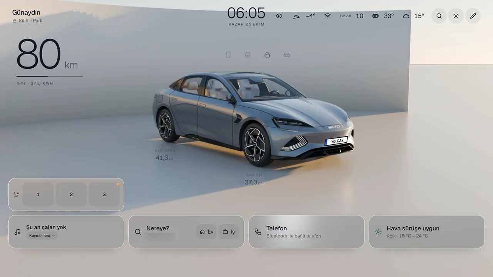
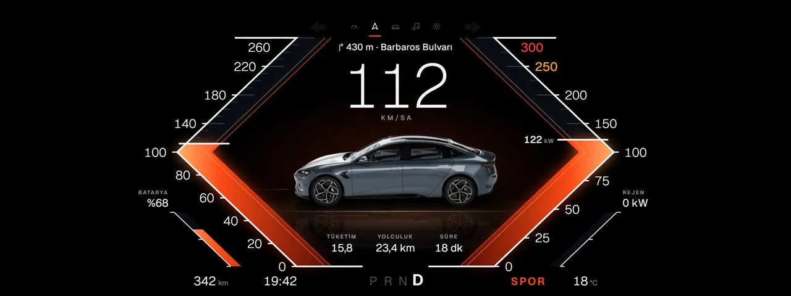
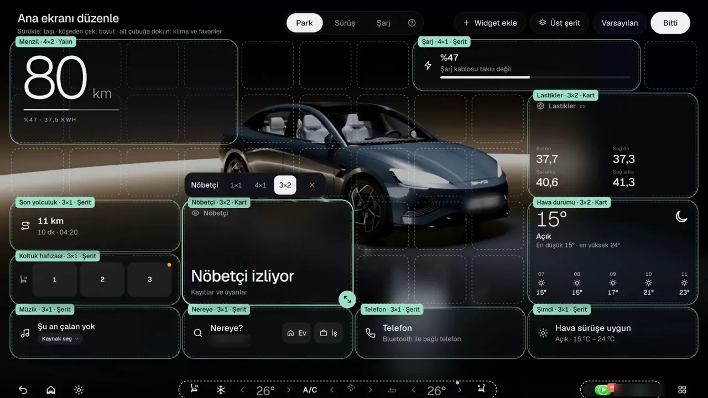
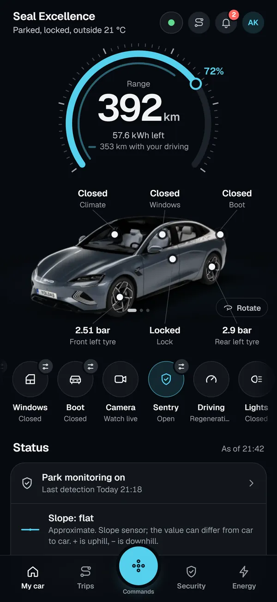
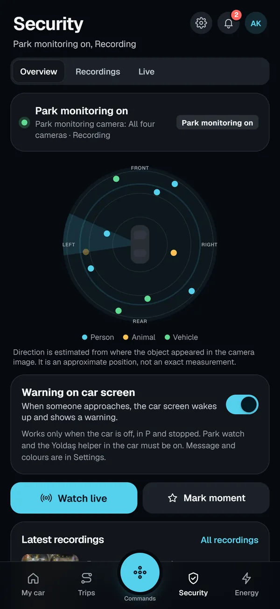
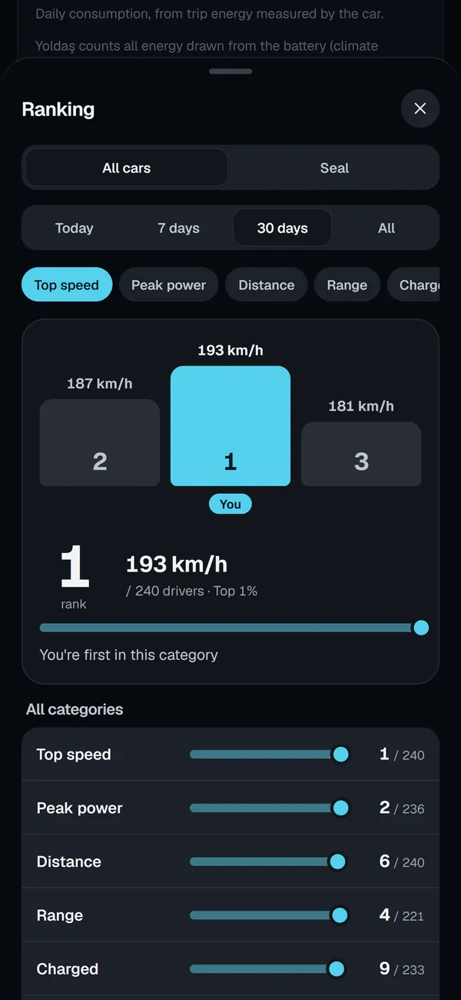

# Yoldaş: the all-in-one app for BYD cars (DiLink)

  

Yoldaş turns your BYD's centre screen into a home screen you design, shows maps and your own designs on the instrument cluster, records with the car's cameras, watches your parked car and lets you control it from your phone. 13 languages, no ads.

> Yoldaş is an independent app; it is not an official BYD app and is not affiliated with BYD. This repository contains documentation and release files only; the source code is not public.

**Other languages:** [Türkçe](README.tr.md) · [Deutsch](https://yoldas.io/de/) · [Nederlands](https://yoldas.io/nl/) · [Português](https://yoldas.io/pt/) · [Polski](https://yoldas.io/pl/) · [Español](https://yoldas.io/es/) · [Français](https://yoldas.io/fr/) · [العربية](https://yoldas.io/ar/) · [한국어](https://yoldas.io/ko/) · [Русский](https://yoldas.io/ru/) · [ไทย](https://yoldas.io/th/) · [中文](https://yoldas.io/zh/)

## Download

Get the latest APK from [Releases](https://github.com/yoldas-io/yoldas/releases/latest) or from [yoldas.io](https://yoldas.io/en/download). Every release lists its SHA-256 and the signing certificate, so you can check the file before installing.

| | |
|---|---|
| APK | `0.15.26` (321) |
| SHA-256 | `ce2e80ebb0364fe4aa000864de2b7aa47f87fda5d75c87a5d850f991b0350306` |
| Signing certificate (SHA-256) | `dd695000acb1d946491b04d2f5f69a019c57c0b6c45588562044fec255a1277e` |

## Install in three steps

1. Download the APK on the car (built-in browser) or copy it to a USB stick.
2. Open it in the car's file manager and tap **Install**. If there is no Install button, use ADB from a computer ([installation guide](https://yoldas.io/en/install)).
3. Open Yoldaş, then pair your phone at **app.yoldas.io** by scanning the QR code on the car screen.

## Guides

- [What are BYD DiLink 3, 4 and 5?](docs/byd-dilink-3-4-5.md)
- [APK not installing on a BYD](docs/byd-apk-not-installing.md)
- [Installing on Sealion 7 and DiLink 5](docs/sealion-7-dilink-5-install-apps.md)
- [Before and after a BYD update](docs/byd-software-update.md)
- [Does BYD have sentry mode?](docs/does-byd-have-sentry-mode.md)
- [Do BYD cameras record?](docs/does-byd-record-dashcam.md)
- [BYD screen rotation](docs/byd-screen-rotation.md)
- [BYD tyre pressure](docs/byd-tyre-pressure.md)
- [BYD app not connecting](docs/byd-app-not-connecting.md)
- [Installing an APK on a BYD from a USB stick](docs/install-apk-byd-usb.md)
- [How to verify an APK's SHA-256 hash](docs/verify-apk-sha256.md)
- [How to choose a car app for your BYD](docs/choose-car-app-byd.md)
- [Automations: what they do and how to use them](docs/how-to-use-automations.md)
- [Charging price and trip cost](docs/charging-price-and-trip-cost.md)
- [Installation](docs/install.md)

## Screenshots

  

## Features

### Home screen and look

- **Yoldaş home screen**: Your 3D car and widgets instead of the BYD home screen.
- **Car appearance**: You choose the drawing's color, wheel color, window tint and license plate.
- **Widgets**: Speed, range, energy, tyres, climate, windows, music, weather and more; drag and resize.
- **Top bar**: Show each item on the left, on the right or not at all; four styles.
- **Your own bottom bar**: Back, home, recent apps, climate and your shortcuts.
- **Split screen**: Split the centre screen into two or three panes; drag to set the ratio.
- **Park, drive and charge layouts**: A separate home screen for each; switches by itself with the gear and the charging cable.
- **On-the-road scene**: Your car in its lane while driving, with nearby vehicles, blind spot and the next turn.
- **Recent apps panel**: Switch between open apps and close the ones you don't need.
- **Screen rotation shortcut**: On cars with a rotating screen, switch landscape and portrait without a steering-wheel button.
- **Day, night and automatic look**: Switches by itself with the light and the time.
- **Units**: km or miles, °C or °F, kW, PS or hp, bar, kPa or psi, 12- or 24-hour clock; kWh/100 km, Wh/km or km/kWh for consumption; L/100 km or mpg for fuel.
- **13 languages**: Turkish, English, German, Dutch, Portuguese, Polish, Arabic, Korean, Spanish, French, Russian, Thai and Chinese.

### Instrument cluster

- **Map on the cluster**: Navigation behind the steering wheel, full screen or as a region.
- **CarPlay and Android Auto on the cluster**: Bring your phone's map to the cluster and the centre screen.
- **Yoldaş clusters**: Horizon, Wing and more, each with day and night versions.
- **Design your own cluster**: Describe it to an AI, test it in the workshop, send it to your car.
- **Community clusters**: Add designs shared by others with one tap.
- **Surroundings on the cluster**: The car or motorbike ahead with its distance, plus cars, trucks and pedestrians around you.
- **Clean mirroring**: When something is shown on the cluster, BYD's frame is hidden and only your choice remains.

### Cameras and security

- **Dashcam**: Records with the car's four cameras, no extra camera needed; while driving, while parked or always.
- **Recording segment length**: You split dashcam recording into 15-second (default), 1-minute or 5-minute segments.
- **Hard-brake protection**: Recordings around hard braking are protected automatically; mark any moment by hand.
- **Sentry mode**: While the car is off, it records and notifies your phone when a person, animal or vehicle is detected.
- **Alert on the car screen**: A coloured warning and recording sign on the screen when someone approaches.
- **Turn-signal camera**: Signal and the camera on that side opens on the centre screen or the cluster.
- **Live 360° view**: Watch the four cameras live on the car screen and on your phone.
- **Recordings in the file manager**: Recordings are saved to a Yoldas folder that BYD's file manager can see.
- **Safe places**: At home or at work, sentry doesn't run and phone automations stay quiet.
- **App lock**: Lock Yoldaş with a PIN; reset it from your phone if you forget it.
- **Pet screen**: A full-screen message, readable from outside, for a pet you leave in the car.

### Car controls

- **Central locking**: Lock or unlock from the car screen, a widget or your phone.
- **Climate**: Temperature, fan, air direction and SYNC; switch it on or off even when the car is off.
- **Windows**: Open each window by percentage, vent them or close them all.
- **Boot**: Open and close it while the car is stationary.
- **Sunroof and sunshade**: Open, close, half; as a widget.
- **Defrost and air recirculation**: Front and rear defrost, fresh or recirculated air.
- **Drive mode and regeneration**: Eco, Normal, Sport, Snow; regeneration level and brake feel.
- **Seat memory**: Save seat, steering wheel and mirror positions to three slots and recall them with one tap.
- **Ambient lighting**: On, off, colour; templates for red when a door is open and colour by climate temperature.
- **Keep the rhythm lights on**: The ambient panel stays lit even when no music is playing.
- **Cabin engine sound**: Electric, V8 or Space; inside the car only, following speed and throttle.

### Automations

- **Your own automations**: Choose the triggers, conditions and actions; dozens of car actions.
- **Build it with AI**: Write what you want in one sentence and get a ready automation.
- **Ready-made templates**: Charge target, save the clip on hard braking, charging cable reminder and more.
- **Unlock on approach, lock on leaving**: With your phone or your BYD key.
- **Steering-wheel buttons**: Link any automation to a button.
- **Location and zones**: Automations that run when you arrive somewhere or leave it.
- **Wi-Fi, mobile data and Bluetooth**: Switch them on or off in an automation; save energy while parked.
- **HTTP request**: Send a request to your smart home or your own server.
- **Play a sound**: Play any sound as one step of an automation.
- **Shortcuts**: Put the same actions on the bottom bar and on widgets.

### Phone app

- **No app store**: Add app.yoldas.io to your home screen; iPhone and Android.
- **My car**: Range, locks, windows, tyres and your 3D car.
- **Instant notifications**: Sentry, charge target, door left open and more.
- **Live camera, listen and talk**: Four cameras live; listen to the cabin and talk to the people inside.
- **Car screen on your phone**: Watch the centre screen from your phone and control it by touch while the car is stationary.
- **Send a route to the car**: Pick the destination on your phone and the car's map opens it.
- **Ranking**: Compare yourself with other drivers anonymously.
- **12 looks**: Choose the design of the phone app.
- **Car transfer**: When you sell the car, your personal data is removed and the licence moves to the new owner.

### Energy and driving

- **Trip computer**: Every trip is saved with its map, speed, power, braking and altitude.
- **Personal range**: Based on the energy left and your consumption over the last 300 km.
- **Charging sessions**: Charging curve, energy added, duration and cost.
- **Cost and savings**: Trip cost with your charging prices, and what you save compared with petrol.
- **Battery health**: Battery report, cell temperature and the 12 V battery.
- **Tyre pressure**: All four tyres, with the recommended pressure.
- **0–100 and driving score**: Acceleration timer, hard-braking and hard-acceleration counter.
- **Slope**: Uphill and downhill, on the car screen and on your phone.
- **Data left on the car's SIM**: Remaining and used mobile data, shown on your phone.

### Installation and updates

- **Signed updates**: New versions download by themselves and install after their signature is checked.
- **Test versions**: Try new features early if you want; they never install by themselves.
- **DiLink 3, 4 and 5**: On every supported BYD model.

## Supported cars

Built for BYD cars with DiLink 3, 4 and 5: [Seal](https://yoldas.io/en/byd-seal) · [Seal U EV](https://yoldas.io/en/byd-seal-u-ev) · [Seal U DM-i](https://yoldas.io/en/byd-seal-u-dm-i) · [Sealion 7](https://yoldas.io/en/byd-sealion-7) · [Atto 3](https://yoldas.io/en/byd-atto-3) · [Atto 2](https://yoldas.io/en/byd-atto-2) · [Dolphin](https://yoldas.io/en/byd-dolphin) · [Dolphin Surf](https://yoldas.io/en/byd-dolphin-surf) · [Han](https://yoldas.io/en/byd-han) · [Tang](https://yoldas.io/en/byd-tang) · [Seal 6 DM-i](https://yoldas.io/en/byd-seal-6-dm-i) · [Sealion 5 DM-i](https://yoldas.io/en/byd-sealion-5-dm-i)

## Phone app

Open **app.yoldas.io** on iPhone or Android and add it to your home screen: car status, commands, four cameras live, trips, charging and ranking. No app store needed.

## In numbers

**700+** cars in the last 30 days · **60,000+** trips recorded · **500,000+** km recorded · **380+** clusters designed

## Frequently asked questions

<b>Does Yoldaş affect my car&#x27;s warranty?</b>

BYD and its authorised service centres decide on warranty matters, so we cannot promise anything. What you should know: Yoldaş does not change the car's system software files, needs no root and no special signature, and installs as an ordinary APK. For cluster display and parking features you have to turn on the local debugging connection on the car. The helper that runs over this connection changes only a few Android settings (such as the accessibility service list, battery-restriction exemption, bottom bar and Wi-Fi), and it undoes them when you uninstall Yoldaş or disconnect. If you are concerned, ask an authorised service centre before installing.

<b>Which BYD models does Yoldaş work with?</b>

Yoldaş is built for the BYD Seal, Seal U EV, Seal U DM-i, Sealion 7, Atto 3, Atto 2, Dolphin, Han, Tang, Dolphin Surf, Seal 6 DM-i and Sealion 5 DM-i. Each model has its own page.

<b>Can I show a map on my BYD&#x27;s instrument cluster?</b>

Yes. A map or an app of your choice opens on the screen behind the steering wheel; the car itself keeps showing speed, gear and warnings. Details are on the <a href="{{u:kadran}}">cluster display page</a>.

<b>Does the side camera open when I signal?</b>

Yes. On the center screen, on the cluster or on both; you choose the position, size and shape. <a href="{{u:sinyal}}">Turn camera</a>

<b>If someone approaches my parked car, will I know?</b>

Yes, if Sentry is on. When it detects a person, an animal or a vehicle while parked, it sends a notification to your phone; if you want, the car screen also warns with the message you wrote. The radar on your phone shows the direction of the event. Park monitoring is experimental and can be wrong; it may not see every event. <a href="{{u:nobetci}}">Parked watch</a>

<b>Does the phone connection continue when the car is off?</b>

Yes. With Phone control and the Yoldaş helper on, the connection continues after the car is switched off. By default there is no battery or 12 V battery limit; if you like, you set a lower limit of 10–60% for the battery or 11–13 V for the 12 V battery, and the connection is released when the value falls below it. It is also released if the gear is not P, if the system gets too hot or if data cannot be read. With the charging cable plugged in, no limit is checked. <a href="{{u:kontrol}}">Remote control</a>

<b>Can I build my own automations?</b>

Yes. You build routines that run when the car turns on, at a set time, when the battery is full or on arriving at a place; A/C, defrost, windows, trunk and driving mode can be added as steps. <a href="{{u:otomasyon}}">Automations</a>

<b>Can I change the bar at the bottom of the screen?</b>

Yes. Yoldaş shows its own bottom bar, and you choose up to six shortcuts in the middle. <a href="{{u:altcubuk}}">Bottom bar</a>

<b>How do I install Yoldaş?</b>

Open the APK file on the car screen, or install it from a computer with ADB. See the steps in the <a href="{{u:kurulum}}">app install guide</a>.

<b>Do I need to reinstall Yoldaş after a BYD update?</b>

Some BYD updates remove apps you installed yourself. If that happens, reinstall Yoldaş and pair it with your phone again. Your history backed up to the server stays where it is.

<b>Does Yoldaş need internet?</b>

The information on the car screen shows without internet. Watching from your phone, phone commands, notifications and backups need the car to be online over Wi-Fi or its own mobile data.

<b>How do I install the phone app?</b>

Open app.yoldas.io on your phone and add it to your home screen. On iPhone, in Safari: Share › Add to Home Screen. On Android, in the Chrome menu: Add to Home screen.

<b>Does Yoldaş cost anything?</b>

It is free during the pilot and has no ads. If we ever move to a paid plan, we will announce it in advance.

<b>Where does my data go?</b>

Sharing of readings and location only turns on with your consent, and the data goes to the Yoldaş server over HTTPS. Camera recordings stay in the car. Details are on the <a href="{{u:guvenlik}}">security</a> and <a href="{{u:gizlilik}}">privacy</a> pages.

<b>Where are camera recordings saved?</b>

In the car, in Yoldaş's own folder. Recordings are not uploaded to the server on their own. You set the storage space; when it fills up, the oldest unprotected recording is deleted. On your phone, you can fetch any recording from the car and download it as an MP4.

<b>Which languages is Yoldaş available in?</b>

Turkish, English, German, French, Spanish, Portuguese, Dutch, Polish, Russian, Arabic, Korean, Thai and Simplified Chinese. Choose the language on the car screen under System › Units and language.

<b>Can I use the cameras with another app at the same time?</b>

Only one app can use the car cameras at a time. While recording or Sentry is on in Yoldaş, keep other camera apps closed.

<b>How do I uninstall Yoldaş?</b>

Select Yoldaş in the app list in the car settings and uninstall it. To delete your history on the server, first delete it in the Account section of the phone app.

<b>Is Yoldaş made by BYD?</b>

No. Yoldaş is an independent app; it is not an official BYD app and is not affiliated with BYD.

## Privacy and security

What leaves the car and what doesn't: [docs/security.md](docs/security.md).

## Release notes

[CHANGELOG.md](CHANGELOG.md)

## Support

Found a bug or have an idea? Open an [issue](https://github.com/yoldas-io/yoldas/issues). For anything private, write to iletisim@yoldas.io.
