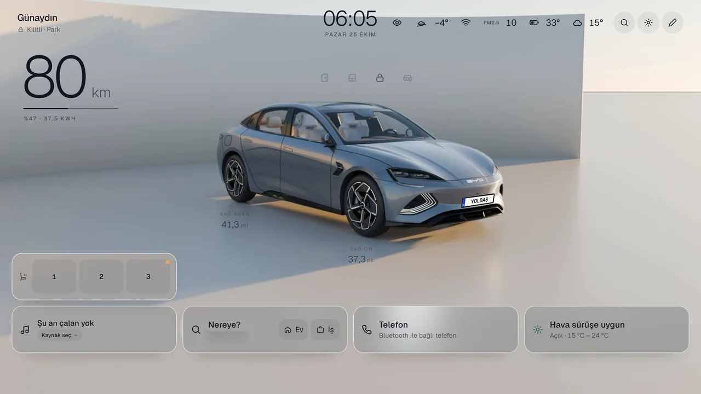
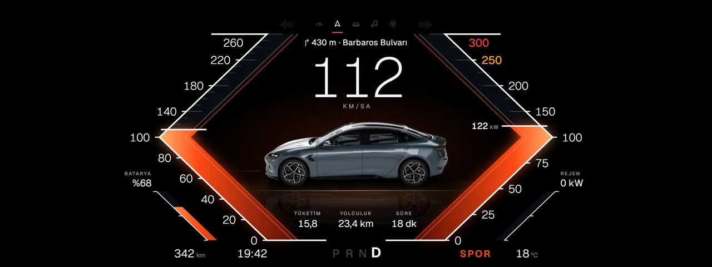
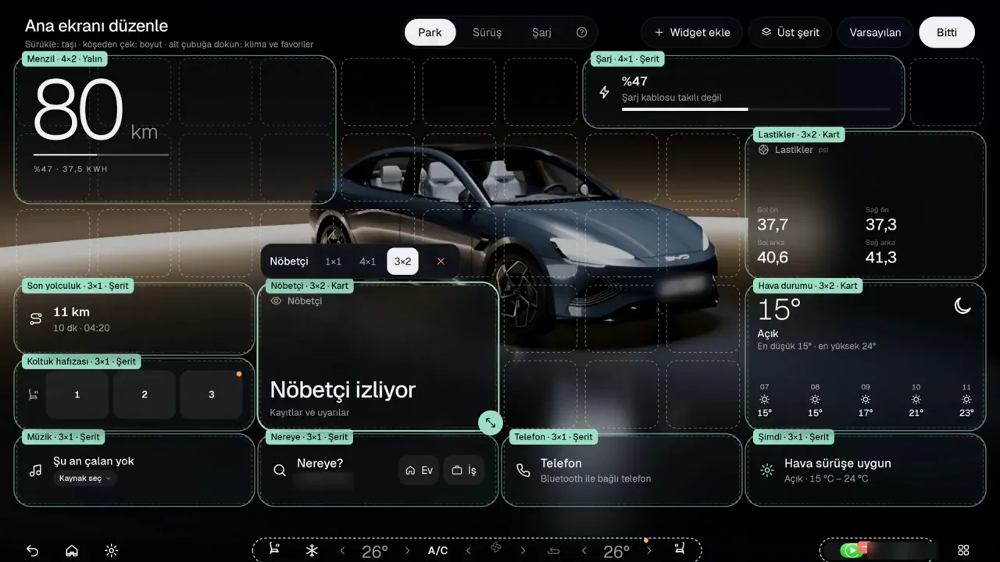
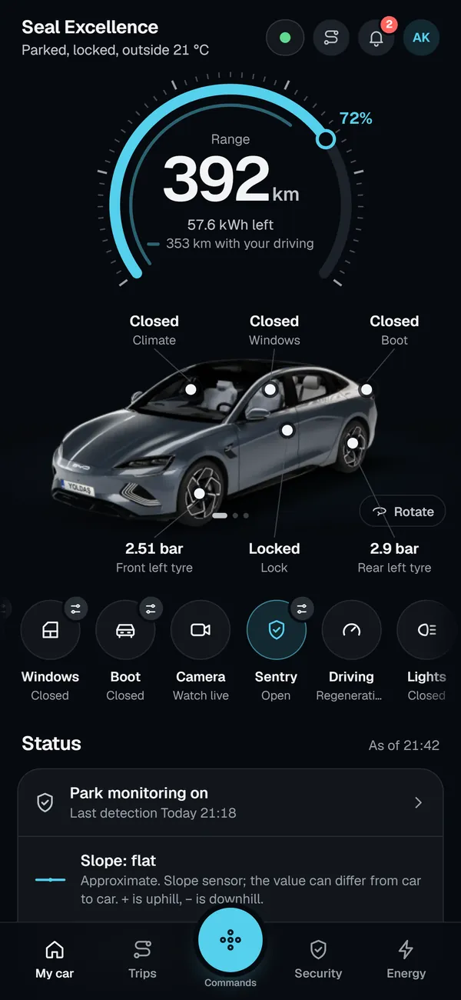
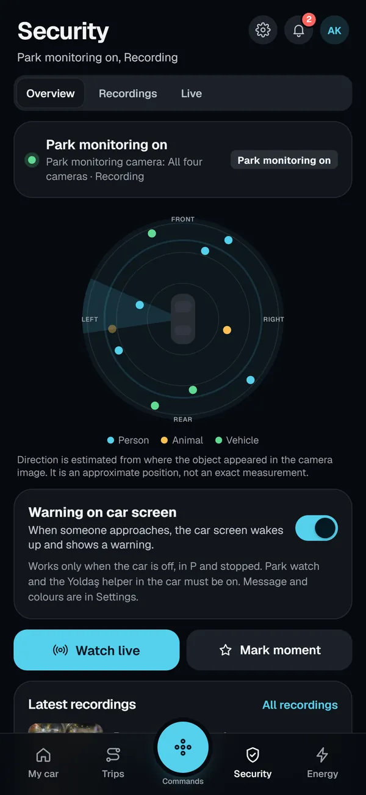
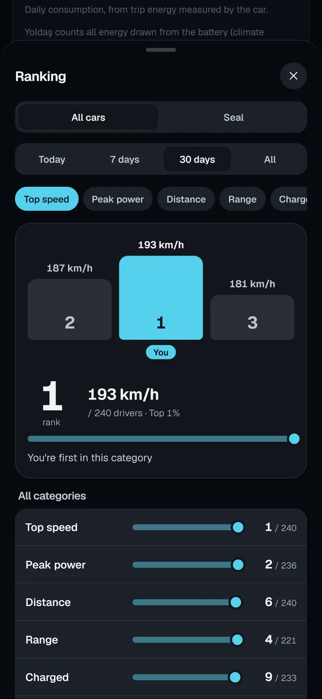

# Yoldaş: BYD araçlar için hepsi bir arada uygulama (DiLink)

  

Yoldaş, BYD'nizin orta ekranını kendi tasarladığınız bir ana ekrana çevirir; göstergeye harita ve kendi tasarımlarınızı getirir, aracın kameralarıyla kayıt alır, park hâlindeki aracınızı izler ve aracı telefondan yönetmenizi sağlar. 13 dil, reklam yok.

> Yoldaş bağımsız bir uygulamadır; BYD'nin resmî uygulaması değildir ve BYD ile bağlantısı yoktur. Bu depoda yalnız belgeler ve sürüm dosyaları bulunur; kaynak kod paylaşılmaz.

**Diğer diller:** [English](README.md) · [Deutsch](https://yoldas.io/de/) · [Nederlands](https://yoldas.io/nl/) · [Português](https://yoldas.io/pt/) · [Polski](https://yoldas.io/pl/) · [Español](https://yoldas.io/es/) · [Français](https://yoldas.io/fr/) · [العربية](https://yoldas.io/ar/) · [한국어](https://yoldas.io/ko/) · [Русский](https://yoldas.io/ru/) · [ไทย](https://yoldas.io/th/) · [中文](https://yoldas.io/zh/)

## İndir

Son APK'yı [Sürümler](https://github.com/yoldas-io/yoldas/releases/latest) bölümünden ya da [yoldas.io](https://yoldas.io/indir) adresinden alın. Her sürümde SHA-256 özeti ve imza sertifikası yazar; kurmadan önce dosyayı doğrulayabilirsiniz.

| | |
|---|---|
| APK | `0.15.26` (321) |
| SHA-256 | `ce2e80ebb0364fe4aa000864de2b7aa47f87fda5d75c87a5d850f991b0350306` |
| İmza sertifikası (SHA-256) | `dd695000acb1d946491b04d2f5f69a019c57c0b6c45588562044fec255a1277e` |

## Üç adımda kurulum

1. APK'yı araç tarayıcısıyla indirin ya da bir USB belleğe kopyalayın.
2. Aracın dosya yöneticisinde açıp **Yükle**ye dokunun. Yükle düğmesi yoksa bilgisayardan ADB ile kurun ([kurulum rehberi](https://yoldas.io/byd-uygulama-yukleme)).
3. Yoldaş'ı açın; telefonda **app.yoldas.io** adresini açıp araç ekranındaki karekodu okutarak eşleyin.

## Ekran görüntüleri

  

## Özellikler

### Ana ekran ve görünüm

- **Yoldaş ana ekranı**: BYD ana ekranının yerine 3B aracın ve widget'ların.
- **Araç görünümü**: Çizimdeki renk, jant rengi, cam koyuluğu ve plaka sizin seçiminiz.
- **Widget'lar**: Hız, menzil, enerji, lastik, klima, camlar, müzik, hava ve daha fazlası; sürükle, boyutlandır.
- **Üst şerit**: Her bilgiyi solda, sağda ya da kapalı göster; dört görünüm.
- **Kendi alt çubuğun**: Geri, ana ekran, son uygulamalar, klima ve kısayolların.
- **Ekran bölme**: Orta ekranı ikiye ya da üçe böl; oranı sürükleyerek ayarla.
- **Park, sürüş ve şarj düzeni**: Her durum için ayrı ana ekran; vitesle ve şarj kablosuyla kendiliğinden değişir.
- **Yolda sürüş sahnesi**: Sürüşte aracın şeritte; çevredeki araçlar, kör nokta ve sonraki dönüş.
- **Son uygulamalar paneli**: Açık uygulamalar arasında geç, istemediğini kapat.
- **Ekranı döndürme kısayolu**: Döner ekranlı araçta direksiyon tuşu olmadan ekranı yatay ya da dikey yap.
- **Gündüz, gece ve otomatik görünüm**: Işığa ve saate göre kendiliğinden geçer.
- **Birimler**: km veya mil, °C veya °F, kW, PS veya hp, bar, kPa veya psi, 12 veya 24 saat; tüketim için kWh/100 km, Wh/km veya km/kWh; yakıt için L/100 km veya mpg.
- **13 dil**: Türkçe, İngilizce, Almanca, Hollandaca, Portekizce, Lehçe, Arapça, Korece, İspanyolca, Fransızca, Rusça, Tayca ve Çince.

### Kadran

- **Kadranda harita**: Navigasyon direksiyonun arkasında, tam ekran ya da bölge olarak.
- **Kadranda CarPlay ve Android Auto**: Telefonundaki haritayı kadrana ve orta ekrana al.
- **Yoldaş kadranları**: Ufuk, Kanat ve daha fazlası; gündüz ve gece hâlleriyle.
- **Kendi kadranını tasarla**: Yapay zekâya tarif et, atölyede dene, aracına gönder.
- **Topluluk kadranları**: Başkalarının paylaştığı tasarımları tek dokunuşla ekle.
- **Kadranda çevre**: Öndeki araç ve motosiklet metresiyle, yandaki araçlar, tırlar ve yayalar.
- **Sade aktarım**: Kadrana bir şey aktarılınca BYD'nin çerçevesi gizlenir, yalnız senin seçtiğin görünür.

### Kameralar ve güvenlik

- **Dashcam**: Ek kamera takmadan aracın dört kamerasıyla kayıt; sürüşte, parkta ya da her zaman.
- **Kayıt parçası uzunluğu**: Dashcam kaydını 15 saniyelik (varsayılan), 1 dakikalık ya da 5 dakikalık parçalara bölersiniz.
- **Ani frende koruma**: Sert frendeki kayıt kendiliğinden korunur; istediğin anı elle işaretlersin.
- **Nöbetçi modu**: Araç kapalıyken kişi, hayvan ve araç algılanınca kayıt ve telefona bildirim.
- **Araç ekranında uyarı**: Biri yaklaşınca ekranda renkli uyarı ve kayıt işareti.
- **Sinyal kamerası**: Sinyal verince o taraftaki kamera orta ekranda ya da kadranda açılır.
- **360° canlı izleme**: Dört kamerayı araç ekranında ve telefonda canlı izle.
- **Kayıtlar dosya yöneticisinde**: Kayıtlar BYD dosya yöneticisinin gördüğü Yoldas klasörüne yazılır.
- **Güvenli yerler**: Evde ya da iş yerinde nöbetçi çalışmaz, telefon akışları susar.
- **Uygulama kilidi**: Yoldaş'ı PIN'le kilitle; unutursan telefondan sıfırla.
- **Evcil hayvan ekranı**: Araçta bıraktığınız hayvan için dışarıdan okunan tam ekran mesaj.

### Araç kontrolleri

- **Merkezi kilit**: Araç ekranından, widget'tan ve telefondan kilitle ya da aç.
- **Klima**: Sıcaklık, fan, hava yönü ve SYNC; araç kapalıyken de açıp kapatırsın.
- **Camlar**: Her camı yüzdeyle aç, havalandır ya da hepsini kapat.
- **Bagaj**: Aç ve kapat; araç dururken.
- **Açılır tavan ve perde**: Aç, kapat, yarım; widget olarak.
- **Buz çözme ve hava sirkülasyonu**: Ön ve arka buz çözme, iç ve dış hava.
- **Sürüş modu ve rejenerasyon**: Eco, Normal, Spor, Kar; geri kazanım ve fren hissi.
- **Koltuk hafızası**: Koltuk, direksiyon ve ayna konumunu üç yuvaya kaydet, tek dokunuşla çağır.
- **Ambiyans**: Aç, kapat, renk; kapı açıkken kırmızı, klima sıcaklığına göre renk şablonları.
- **Ritim ışıklarını sabit yak**: Müzik çalmasa da ambiyans paneli yanık kalır.
- **Kabin motor sesi**: Elektrik, V8 ya da Uzay; yalnız aracın içinde, hıza ve gaza göre.

### Otomasyonlar

- **Kendi akışların**: Tetik, koşul ve eylemleri sen seç; onlarca araç eylemi.
- **Yapay zekâyla kur**: Ne istediğini bir cümleyle yaz, akış hazır gelsin.
- **Hazır şablonlar**: Şarj hedefi, sert frende kayıt, kablo hatırlatması ve daha fazlası.
- **Yaklaşınca aç, uzaklaşınca kilitle**: Telefonla ya da BYD anahtarıyla.
- **Direksiyon tuşları**: Bir tuşa istediğin akışı bağla.
- **Konum ve bölge**: Bir yere varınca ya da oradan ayrılınca çalışan akışlar.
- **Wi-Fi, mobil veri ve Bluetooth**: Akışla aç ya da kapat; parkta enerji kazan.
- **HTTP isteği**: Ev otomasyonuna ya da kendi sunucuna istek gönder.
- **Ses çalma**: Akışın bir adımında istediğin sesi çal.
- **Kısayollar**: Aynı eylemleri alt çubuğa ve widget'a koy.

### Telefon uygulaması

- **Mağazasız kurulum**: app.yoldas.io'yu ana ekrana ekle; iPhone ve Android.
- **Aracım**: Menzil, kilit, camlar, lastikler ve 3B araç.
- **Anında bildirimler**: Nöbetçi, şarj hedefi, kapı açık kaldı ve daha fazlası.
- **Canlı kamera, dinle ve konuş**: Dört kamera canlı; kabini dinle, araçtakilerle konuş.
- **Araç ekranı telefonda**: Orta ekranı telefondan izle, araç dururken dokunarak yönet.
- **Araca rota gönder**: Hedefi telefonda seç, aracın haritası açılsın.
- **Sıralama**: Öbür sürücülerle isimsiz karşılaştırma.
- **12 görünüm**: Telefon uygulamasının tasarımını sen seç.
- **Araç devri**: Aracı satarken kişisel verilerin silinir, lisans yeni sahibe geçer.

### Enerji ve sürüş

- **Yol bilgisayarı**: Her yolculuk haritasıyla, hız, güç, fren ve rakımla kaydedilir.
- **Kişisel menzil**: Kalan enerji ve senin son 300 km'lik tüketiminle.
- **Şarj oturumları**: Şarj eğrisi, eklenen kWh, süre ve tutar.
- **Maliyet ve tasarruf**: Şarj fiyatlarınla yolculuk maliyeti, benzinliye göre kazancın.
- **Pil sağlığı**: Batarya raporu, hücre sıcaklığı ve 12 V akü.
- **Lastik basıncı**: Dört lastik, önerilen basınçla birlikte.
- **0–100 ve sürüş puanı**: Hızlanma ölçer, sert fren ve hızlanma sayacı.
- **Eğim**: Yokuş ve iniş, araç ekranında ve telefonda.
- **Aracın SIM'inde kalan internet**: Kalan ve kullanılan veri telefonunda.

### Kurulum ve güncelleme

- **İmzalı güncellemeler**: Yeni sürüm kendiliğinden iner, imzası denetlenip kurulur.
- **Test sürümleri**: İstersen yenilikleri önce dene; kendiliğinden kurulmaz.
- **DiLink 3, 4 ve 5**: Desteklenen BYD modellerinin hepsinde.

## Desteklenen araçlar

DiLink 3, 4 ve 5'li BYD'ler için: [Seal](https://yoldas.io/byd-seal) · [Seal U EV](https://yoldas.io/byd-seal-u-ev) · [Seal U DM-i](https://yoldas.io/byd-seal-u-dm-i) · [Sealion 7](https://yoldas.io/byd-sealion-7) · [Atto 3](https://yoldas.io/byd-atto-3) · [Atto 2](https://yoldas.io/byd-atto-2) · [Dolphin](https://yoldas.io/byd-dolphin) · [Dolphin Surf](https://yoldas.io/byd-dolphin-surf) · [Han](https://yoldas.io/byd-han) · [Tang](https://yoldas.io/byd-tang) · [Seal 6 DM-i](https://yoldas.io/byd-seal-6-dm-i) · [Sealion 5 DM-i](https://yoldas.io/byd-sealion-5-dm-i)

## Telefon uygulaması

iPhone ya da Android'de **app.yoldas.io** adresini açıp ana ekrana ekleyin: aracın durumu, komutlar, dört kamera canlı, yolculuklar, şarj ve sıralama. Mağaza gerekmez.

## Rakamlarla

**700+** araç, son 30 günde · **60.000+** yolculuk kaydedildi · **500.000+** km yol kaydedildi · **380+** kadran tasarlandı

## Sık sorulan sorular

<b>Yoldaş araç garantimi etkiler mi?</b>

Garanti kararını BYD ve yetkili servisleri verir; bu konuda söz veremeyiz. Bilmeniz gerekenler: Yoldaş araç yazılımının (sistem bölümünün) dosyalarını değiştirmez, root ya da özel imza gerektirmez; sıradan bir APK olarak kurulur. Kadrana aktarım ve park özellikleri için araçta yerel hata ayıklama bağlantısını açmanız gerekir. Bu bağlantıyla çalışan yardımcı yalnız birkaç Android ayarını (erişilebilirlik servisi listesi, pil kısıtı muafiyeti, alt çubuk ve Wi-Fi gibi) değiştirir; Yoldaş'ı kaldırdığınızda ya da bağlantıyı kestiğinizde bunları geri alır. Kaygınız varsa kurmadan önce yetkili servise sorun.

<b>Yoldaş hangi BYD modellerinde çalışır?</b>

Yoldaş; BYD Seal, Seal U EV, Seal U DM-i, Sealion 7, Atto 3, Atto 2, Dolphin, Han ve Tang için hazırlandı. Her modelin kendi sayfası var.

<b>BYD gösterge paneline harita açılır mı?</b>

Evet. Yoldaş ile direksiyon arkasındaki ekranda harita ya da seçtiğiniz bir uygulama açılır; hız, vites ve uyarıları aracın kendisi göstermeye devam eder. Ayrıntılar <a href="{{u:kadran}}">kadrana aktarım sayfasında</a>.

<b>Sinyal verince yan kamera açılır mı?</b>

Evet. Orta ekranda, kadranda ya da ikisinde; konumu, boyutu ve şekli siz seçersiniz. <a href="{{u:sinyal}}">Sinyal kamerası</a>

<b>Park hâlinde biri araca yaklaşırsa haber alır mıyım?</b>

Evet, Nöbetçi açıksa. Park hâlinde kişi, hayvan ya da araç algılayınca telefonunuza bildirim gönderir; isterseniz araç ekranı da sizin yazdığınız mesajla uyarır. Telefondaki radar olayın yönünü gösterir. Park gözlemi deneyseldir ve yanılabilir; her olayı görmeyebilir. <a href="{{u:nobetci}}">Nöbetçi modu</a>

<b>Araç kapanınca telefonla bağlantı sürer mi?</b>

Evet. Telefondan kontrol ve Yoldaş yardımcısı açıkken kontak kapandıktan sonra da bağlantı sürer. Varsayılan olarak pil ve 12 V akü sınırı yoktur; isterseniz pil için %10–60, akü için 11–13 V arasında bir alt sınır koyarsınız ve sınırın altına inince bağlantı bırakılır. Vites P değilse, sistem çok ısınırsa ya da veri okunamazsa da bırakılır. Şarj kablosu takılıyken sınır aranmaz. <a href="{{u:kontrol}}">Telefondan kontrol</a>

<b>Kendi otomasyonlarımı kurabilir miyim?</b>

Evet. Araç açılınca, belirli saatte, pil dolunca ya da bir konuma girince çalışan akışlar kurarsınız; klima, buz çözme, camlar, bagaj ve sürüş modu adım olarak eklenir. <a href="{{u:otomasyon}}">Otomasyonlar</a>

<b>Ekranın altındaki çubuğu değiştirebilir miyim?</b>

Evet. Yoldaş kendi alt çubuğunu gösterir; en çok altı kısayolu siz seçersiniz. <a href="{{u:altcubuk}}">Alt çubuk</a>

<b>Yoldaş&#x27;ı nasıl kurarım?</b>

APK dosyasını araç ekranında açarak ya da bilgisayardan ADB ile kurarsınız. Adımlar <a href="{{u:kurulum}}">uygulama yükleme rehberinde</a>.

<b>BYD güncellemesinden sonra Yoldaş&#x27;ı yeniden kurmam gerekir mi?</b>

Bazı BYD güncellemeleri sonradan kurulan uygulamaları kaldırır. Böyle olursa Yoldaş'ı yeniden kurup telefonunuzla eşleyin. Sunucuya yedeklenen geçmişiniz yerinde durur.

<b>Yoldaş internet ister mi?</b>

Araç ekranındaki bilgiler internetsiz de görünür. Telefondan izleme, telefon komutları, bildirimler ve yedekleme için aracın Wi-Fi veya kendi mobil verisiyle internete bağlı olması gerekir.

<b>Telefon uygulamasını nasıl kurarım?</b>

Telefonda app.yoldas.io adresini açın ve ana ekrana ekleyin. iPhone'da Safari'de Paylaş › Ana Ekrana Ekle, Android'de Chrome menüsünde Ana ekrana ekle.

<b>Yoldaş ücretli mi?</b>

Pilot döneminde ücretsizdir ve reklam yoktur. Ücretli bir plana geçilirse önceden duyururuz.

<b>Verilerim nereye gidiyor?</b>

Ölçüm ve konum gönderimi sizin onayınızla açılır ve Yoldaş'ın sunucusuna HTTPS ile gider. Kamera kayıtları araçta kalır. Ayrıntılar <a href="{{u:guvenlik}}">güvenlik</a> ve <a href="{{u:gizlilik}}">gizlilik</a> sayfalarında.

<b>Kamera kayıtları nereye kaydediliyor?</b>

Araçta, Yoldaş'ın kendi klasöründe. Kayıtlar kendiliğinden sunucuya yüklenmez. Kayıt alanını siz belirlersiniz; dolunca korunmayan en eski kayıt silinir. İstediğiniz kaydı telefonda araçtan alıp MP4 olarak indirebilirsiniz.

<b>Yoldaş hangi dillerde?</b>

Türkçe, İngilizce, Almanca, Fransızca, İspanyolca, Portekizce, Hollandaca, Lehçe, Rusça, Arapça, Korece, Tayca ve Basitleştirilmiş Çince. Dili araç ekranında Sistem › Birimler ve dil bölümünden seçersiniz.

<b>Kameraları başka bir uygulamayla aynı anda kullanabilir miyim?</b>

Araç kameralarını aynı anda tek bir uygulama kullanabilir. Yoldaş'ta kayıt veya nöbetçi açıkken başka bir kamera uygulamasını kapalı tutun.

<b>Yoldaş&#x27;ı nasıl kaldırırım?</b>

Araç ayarlarındaki uygulama listesinden Yoldaş'ı seçip kaldırabilirsiniz. Sunucudaki geçmişinizi silmek için önce telefon uygulamasında Hesap bölümünden geçmişi silin.

<b>Yoldaş BYD&#x27;nin uygulaması mı?</b>

Hayır. Yoldaş bağımsız bir uygulamadır; BYD'nin resmî uygulaması değildir ve BYD ile bağlantılı değildir.

## Gizlilik ve güvenlik

Araçtan neyin çıkıp neyin çıkmadığı: [docs/guvenlik.md](docs/guvenlik.md).

## Sürüm notları

[CHANGELOG.tr.md](CHANGELOG.tr.md)

## Destek

Bir hata buldunuz ya da öneriniz mi var? Bir [konu (issue)](https://github.com/yoldas-io/yoldas/issues) açın. Kişisel konular için iletisim@yoldas.io adresine yazın.
